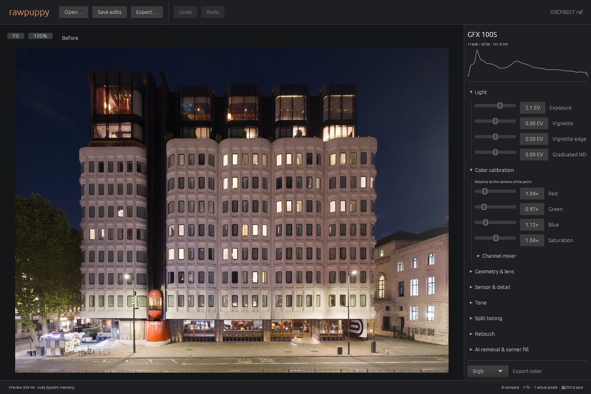
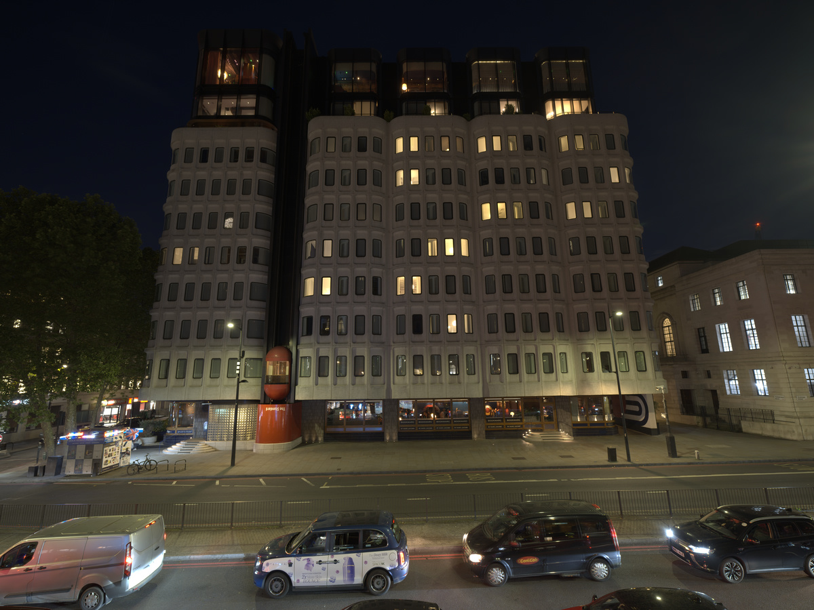
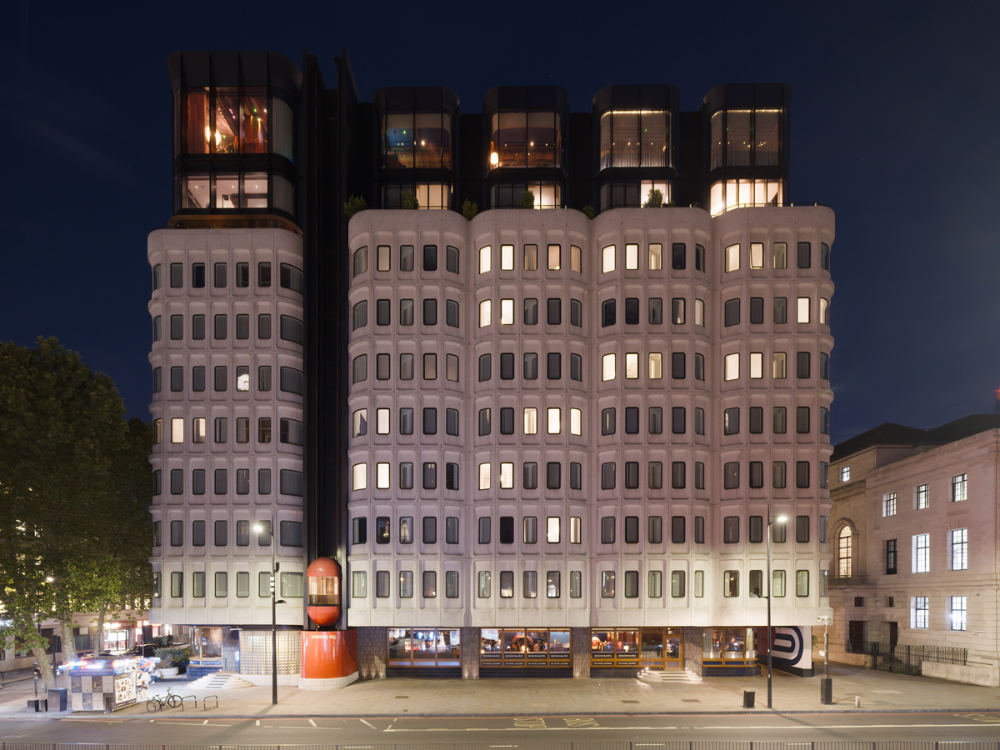
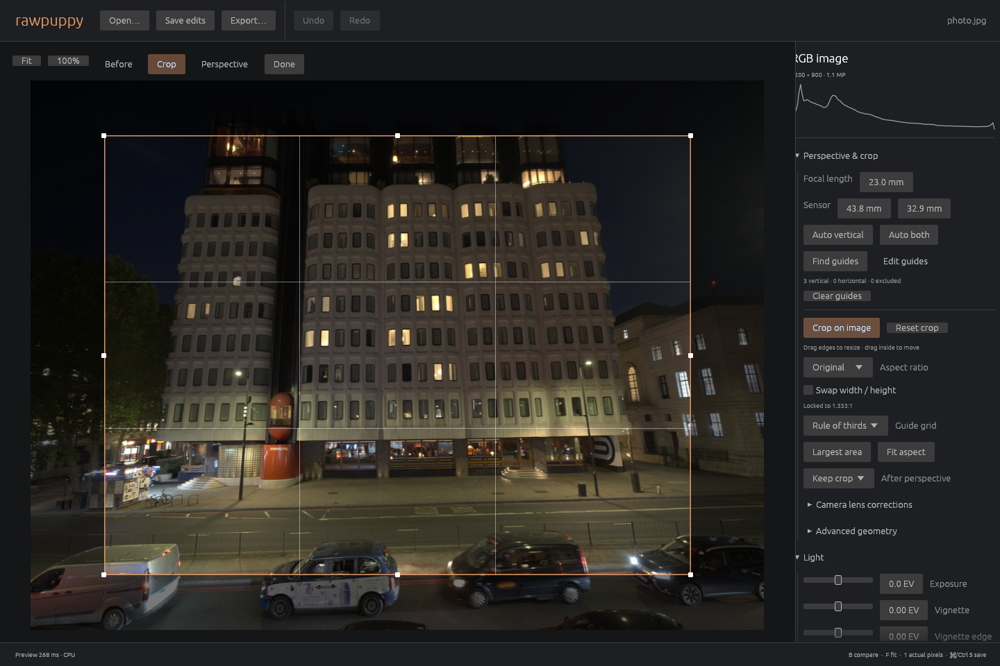

# Rawpuppy

A minimal, opinionated, non-destructive RAW photo editor in Rust. One photo,
a fixed processing order, and edits saved as `photo.raf.rawpuppy.xmp` independently
of other editors. Development is ongoing; current capabilities and remaining
requirements are recorded in [docs](docs).
The CLI `save` command requires the `.rawpuppy.xmp` suffix for its output.



The Standard, London — DSCF0027, Fujifilm GFX 100S. Both images are 1200-pixel-wide
exports from the same RAW: a linear SDR preview before editing, and automatic
two-axis perspective correction, exposure/color calibration and AgX tone mapping after.
The camera calibration and embedded lens corrections are applied in both.
Color calibration supports an illuminant color picker, temperature controls,
and estimation from the whole image or a drawn neutral box.

| Before | After |
| --- | --- |
|  |  |

<details>
<summary>Crop and perspective tools</summary>




</details>

Requires a recent stable Rust toolchain and Little CMS 2 development libraries
(`liblcms2-dev` on Debian/Ubuntu; `brew install little-cms2` on macOS).
Linux X11 windows also require `libxkbcommon-x11-0` at runtime.

```sh
cargo build --release
cargo run --release
cargo run --release -- edit photo.raf
cargo run --release -- inspect photo.raf
cargo run --release -- perspective photo.raf --output corrected.png
cargo run --release -- export photo.raf photo.png
cargo run --release -- export photo.raf preview.jpg --max-edge 1800 --exposure 1
cargo run --release -- recipe > edits.json
cargo run --release -- save edits.json photo.raf.rawpuppy.xmp
cargo test
```

To build and run with every feature enabled (CUDA, AI removal/corner filling,
joint RAW reconstruction and SAM 3 architectural masks):

```sh
# First configure matching LibTorch 2.13; see the setup links below.
cargo build --release --all-features
cargo run --release --all-features -- edit photo.raf
```

The AI tools also need prepared models: [Moebius](docs/moebius.md),
[RAW reconstruction](docs/learned-reconstruction.md), and
[SAM 3](docs/perspective-correction.md#optional-sam-3).

PNG/TIFF export is 16-bit; JPEG is 8-bit. `--color-space` selects sRGB,
Display P3, Adobe RGB, Rec.2020, or linear sRGB, with embedded ICC profiles.
TIFF automatically uses BigTIFF when its size requires 64-bit offsets.
EXR stores floating-point linear sRGB with explicit primaries
(`--color-space linear-srgb`); tagged HDR input chromaticities are respected.
Use `--overwrite` to replace an existing export. Originals are never overwritten
by export; the CLI defaults to eight CPU workers to share the workstation.
Photo compute automatically tries CUDA, then native Vulkan/Metal, then CPU when
unavailable; no backend flag is needed. CUDA is included in the default build and
loaded at runtime, so building does not require a CUDA SDK. Using CUDA requires
the NVIDIA driver and CUDA toolkit (NVRTC and headers); set `CUDA_PATH` for a
nonstandard toolkit location. `--backend auto|cpu|cuda|vulkan|metal` overrides
automatic selection. Auto also selects CPU for unsupported sources or device
limits; GPU sources stay resident between
edits. `cargo build --no-default-features` omits photo compute acceleration;
add `--features gpu` for Vulkan/Metal without CUDA.
Eligible coherent CUDA devices share the existing sensor/output allocations;
[system-memory.md](docs/system-memory.md) describes selection and GB10 measurements.

In the editor: drop a photo to open it, scroll to zoom, drag to pan, `F` to fit,
`1` for actual pixels, and `B` to compare. Save with `Ctrl/Cmd S`; undo with
`Ctrl/Cmd Z`. Clone/heal uses Alt-click to choose a source. A custom monitor ICC
can be selected in the editor or passed with `edit --display-profile monitor.icc`.
Automatic display selection and platform policies are described in [display color](docs/display-color.md).
`edit photo.exr --hdr` requests native HDR preview with automatic SDR fallback;
see [HDR presentation](docs/hdr-presentation.md) for signal and platform limits.
New RAF documents use available camera distortion, vignetting and CA corrections; existing
recipes retain their saved behavior. See [lens correction](docs/lens-correction.md).
**Perspective & crop** offers automatic detection and editable guide segments (`P`),
draggable crop edges (`C`), aspect presets, composition grids, and automatic crops
that exclude empty corners. Draw a horizontal or vertical line with **Straighten** (`S`)
to level a photo, or adjust rotation in 0.1° steps. Toggle the grid independently with `G`.
Draw a graduated filter directly on the image under **Light**. **Detail** provides subtle
sharpening and local contrast. Detailed geometry controls live under **Advanced geometry**.
See [perspective and crop](docs/perspective-correction.md) and [direct controls and detail](docs/detail-and-direct-controls.md).

The optional `moebius` feature adds native AI removal and corner filling, saved as
non-destructive layers. See [runtime setup](docs/moebius.md) and [model evaluation](docs/inpainting-research.md).
The optional `raw-ml` feature adds experimental joint AI Bayer reconstruction
with a reusable editor/export cache; see [setup and validation](docs/learned-reconstruction.md).
