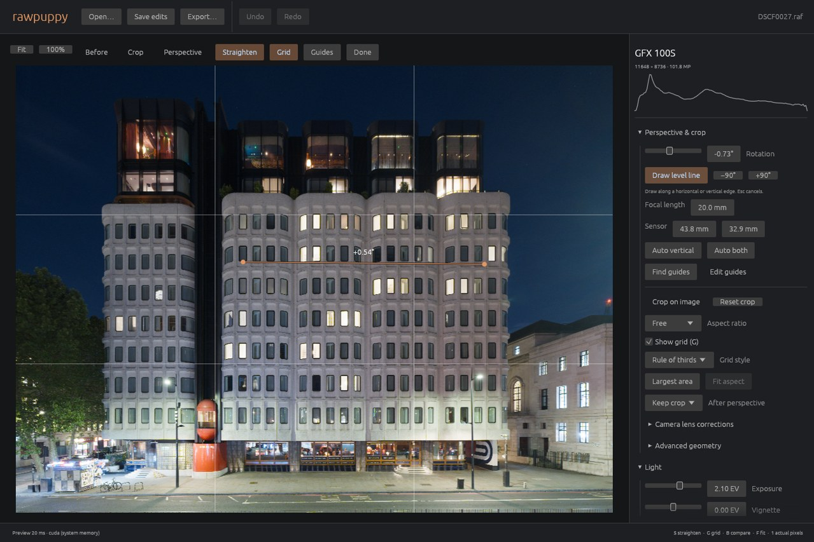

# Fine rotation, direct adjustments and detail

Made rotation a first-class perspective control with 0.1° steps, a small normal
adjustment range, unrestricted numeric entry and quarter-turn buttons. Added an
on-photo leveling line with residual-angle feedback, aspect-aware horizontal or
vertical snapping, and exact single-step undo/redo. It preserves pitch, yaw,
framing and all other edits. Existing automatic estimates retain full precision
when the control is displayed.

Moved alignment grid access onto the preview toolbar and added an independent
`G` toggle and style menu. It works with view, rotation, crop, perspective and
retouch tools. Added graduated ND drawing to set both position axes, transition
width and direction together. Shift-wheel resizes retouch/removal brushes without
zooming. Camera names wrap inside a padded, slightly wider sidebar; native
inspection caught that wrapping alone did not fix the original left clipping.

Added final luminance sharpening and edge-aware local contrast with conservative
bounds on noise and edge overshoot. New documents use 0.2 sharpening; historical
sidecars remain unchanged. Detail is applied after generated fills and excluded
from their context hash, so changing detail neither invalidates saved fills nor
leaves them with mismatched sharpening. Perspective detection excludes detail.
The spatial stage uses bounded overlapping CPU tiles after the existing GPU
composition; zero detail bypasses it. See [behavior and implementation](detail-and-direct-controls.md).

Validation covers precise slider display and 0.1° keys; leveling at zoom with
crop/perspective; drag reversal, cancellation and middle-pan; single-step
undo/redo; graduated-filter coordinates; long camera names; Shift-wheel; legacy
serialization/hashes; texture/noise/strong edges; transparent borders; HDR; saved
fills; and viewport/export-strip consistency. Native Vulkan and CUDA agree with
the CPU within 0.00003 per channel. Physical Metal was not available.

Used an owned copy of the 101.8 MP GFX London RAW for real native interaction,
full-resolution baseline/detail export, and visual inspection of 1:1 masonry,
window and illuminated-edge crops. Native line leveling changed only roll by
+0.53671° and undo restored the exact recipe. Full-resolution CUDA system-memory
rendering took 1.18 s without detail and 7.22 s with sharpen 0.2 / local contrast
0.2; these are single runs, with other work active on the machine. The final
spatial stage is CPU-based and accounts for additional processing. Original RAWs,
Darktable sidecars and cooked references were not modified.

All-feature tests: 161 passed, 32 device/model-dependent tests ignored. The detail
parity test was additionally run explicitly on both Vulkan and CUDA. Strict
Clippy 1.99 for all features/targets, formatting and whitespace checks passed.
See [machine-readable results](data/usability-detail-2026-10-16.json).

